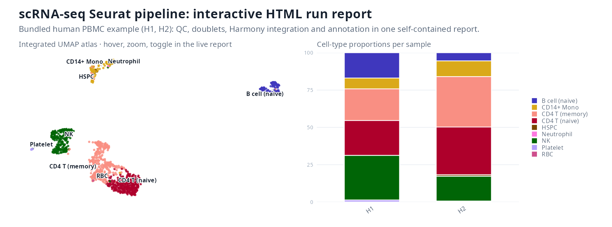

# scRNA-seq Seurat Pipeline

[](LICENSE)
[](pipeline/setup_env.sh)
[](https://satijalab.org/seurat/)
[](#requirements)
[](https://github.com/alvin8-git/scRNA/releases)
[](https://github.com/alvin8-git/scRNA/commits/master)

Turns single-cell count matrices from MGI DNBelab C4, 10x CellRanger or Parse Biosciences into
an annotated, integrated atlas, per-stage PDF reports, and one self-contained HTML report that
opens with a double-click. Built on Seurat v5, Harmony and SingleR, driven by one shell command.

<p align="center">
  
</p>
<p align="center"><sub>Figure 1. What <code>run_pipeline.sh</code> does. Source: <a href="docs/img/pipeline_overview.mmd">docs/img/pipeline_overview.mmd</a></sub></p>

## Quick start

You need Linux, conda with mamba, and at least 8 GB of RAM (the per-worker budget of the RAM governor).

```bash
git clone https://github.com/alvin8-git/scRNA.git
cd scRNA
bash pipeline/setup_env.sh            # one time: builds the scrna_seurat conda env (10-20 min)
bash pipeline/run_pipeline.sh Samples/H1 Samples/H2
```

Then open `Results/results_H1-H2_filtered/reports/H1-H2_report.html` in a browser. The file is
self-contained: no server, no internet connection.

`run_pipeline.sh` activates the conda environment itself. For standalone `Rscript` calls, run
`conda activate scrna_seurat` first.

## Smoke test: human PBMC

`Samples/H1` and `Samples/H2` are two small human PBMC libraries (DNBelab C4 output) committed
with the repo. Running them checks that the environment, every default step and the report build
all work on your machine.

**1. Pre-flight checks** (seconds each):

```bash
conda activate scrna_seurat
Rscript pipeline/validate_config.R          # expect: Config validation passed.
Rscript pipeline/tests/test_regressions.R   # expect: All regression checks passed.
```

**2. Run the example:**

```bash
bash pipeline/run_pipeline.sh Samples/H1 Samples/H2
```

With an environment freshly built by `setup_env.sh`, on a 64-core Linux server with 125 GB RAM
(the RAM governor chose 8 workers), the run took **4 min 03 s** and the largest single process
peaked at **1.8 GB** RAM. Building the environment took about 5 minutes. Expect longer on fewer
cores.

**3. Check the outputs.** All of these should exist under `Results/results_H1-H2_filtered/`:

| File | What it is |
|---|---|
| `qc/cell_fate.csv` | Cells kept and removed at each filter, per sample |
| `integrated/integrated_annotated.rds` | The annotated, Harmony-integrated Seurat object |
| `01-QC_report.pdf` to `05-Integrated_report.pdf`, `Overall_report.pdf` | Per-stage PDF reports |
| `reports/H1-H2_report.html` | The interactive HTML report (about 6 MB) |

**4. Check the result.** A correct run keeps about **1,250 cells** (H1 372, H2 882 in our run;
see `qc/cell_fate.csv`) and labels the main PBMC populations: memory and naive CD4 T (about 30%
each), NK (about 20%), CD14+ monocytes and naive B cells (about 9% each), with small platelet
and HSPC groups.

One memory CD4 T cluster also carries high haemoglobin RNA (likely ambient contamination). Other
package builds can label it RBC instead, and doublet counts can differ by a few cells, so
compare populations rather than exact numbers.

## Supported specimen types

The species keyword on the command line selects marker panels, the SingleR reference, QC limits
and clustering resolutions. Every type below runs through the same steps and the same report.

| Specimen | How to select it | Label reference | Status |
|---|---|---|---|
| Human PBMC | default (no keyword) | `HumanPrimaryCellAtlas` | Validated |
| Human whole blood | default, plus `SINGLER_REF <- "MonacoImmune"` in `pipeline/config.R` | `MonacoImmune` | Validated |
| Bat whole blood (*Eonycteris spelaea*) | `bat` | `MonacoImmune` (human), plus a frozen bat reference when available | Validated |
| Bat wing tissue (*E. spelaea*) | `bat_wing` | `HumanPrimaryCellAtlas` | Validated |
| Human ESC/iPSC to cardiomyocyte differentiation | `cm` | `HumanPrimaryCellAtlas` | Validated |
| Mouse immune cells | `mouse` | `ImmGen` | Experimental |

**Limitations, per specimen**

- **Human PBMC.** The broad reference gives coarse labels, and labels are run-relative: the same
  sample can shift a few percent when run alongside different samples (no frozen human reference
  ships). Doublet rates are set only for the bundled H1/H2; other samples get scDblFinder's
  automatic estimate.
- **Human whole blood.** There is no keyword; you must edit `SINGLER_REF` by hand and revert it
  afterwards. Red cells and neutrophils are expected here, so they are not flagged as contamination.
- **Bat whole blood.** Labels come from a human reference applied across species, which
  under-calls neutrophils and CD8 T cells. The fix is the frozen bat reference
  (`Results/frozen_reference/`), which is not in this repository: without it, step 05r skips
  with a warning and labels stay de-novo. See
  [docs/howto-frozen-reference.md](docs/howto-frozen-reference.md) to build one.
- **Bat wing tissue.** The human reference swaps fibroblast and smooth-muscle calls in wing
  tissue, so a curated `CLUSTER_CELLTYPE_MAP` is needed for each new cohort. QC caps are raised
  (8,000 genes, 60,000 UMIs) for large cells. Wing steps 11 to 14 need the optional packages from
  `bash pipeline/setup_extras.sh` (CellChat, monocle3); steps 12 and 13 skip when a run has only one condition. No frozen reference exists for wing.
- **Cardiomyocyte differentiation.** `HumanPrimaryCellAtlas` has no cardiomyocyte label, so
  cell types come from lineage marker panels and a curated `CLUSTER_CELLTYPE_MAP`; the shipped
  maps fit only the cohorts they were curated on. QC limits are raised (1,000 to 9,000 genes,
  up to 70,000 UMIs). The monocle3 trajectory (`pipeline/projects/cm/trajectory.R`) runs by hand and needs
  `bash pipeline/setup_extras.sh`.
- **Mouse immune cells.** Not validated: the marker panels are checked against a real mouse
  feature list, but no one has confirmed the resulting cell-type calls. QC limits are
  provisional. A `mouse_cm` profile (cardiac panels) exists but is selected only through
  `SCRNA_SPECIES=mouse_cm`, not a runner keyword. Treat mouse output as unreviewed.

Anything not listed (other species or tissues) will run on the human defaults, but the labels
are not meaningful without a marker panel and reference for that tissue.

## Run it on your own data

Each sample is a folder holding a count matrix. The pipeline detects the layout:

| Source | Folder layout |
|---|---|
| [MGI DNBelab C Series](https://github.com/MGI-tech-bioinformatics/DNBelab_C_Series_HT_scRNA-analysis-software) | `filter_matrix/` (required), `raw_matrix/` (optional) |
| 10x CellRanger | `filtered_feature_bc_matrix/`, `raw_feature_bc_matrix/` |
| Parse Biosciences split-pipe | `DGE_filtered/`, `DGE_unfiltered/` |

```bash
bash pipeline/run_pipeline.sh /path/to/SampleA                         # one sample, no integration
bash pipeline/run_pipeline.sh /path/to/A /path/to/B /path/to/C        # Harmony integration
bash pipeline/run_pipeline.sh bat /path/to/A /path/to/B               # species keyword
bash pipeline/run_pipeline.sh condition="A=healthy,B=treated" /path/to/A /path/to/B
bash pipeline/run_pipeline.sh /path/to/A /path/to/B 05 06 07          # re-run only these steps
bash pipeline/run_pipeline.sh --help
```

Arguments can come in any order. A path is a sample, `human` / `bat` / `bat_wing` / `cm` /
`mouse` set the species, `condition=…` labels groups for differential expression, and anything
else is a step number. Single-sample runs skip integration and therefore skip the HTML report.

## Deploying on a server

**Requirements.** Linux with conda and mamba (`setup_env.sh` installs R 4.4.3, Seurat 5.4.0,
Harmony, SingleR, scDblFinder, SoupX, edgeR and the report stack). The bat-wing steps and
the cm trajectory also need `bash pipeline/setup_extras.sh`, which builds CellChat, monocle3,
SeuratWrappers and presto from GitHub source; the core pipeline and the smoke test do not. macOS is untested. Memory scales with cell count: the RAM governor in
`pipeline/config.R` budgets about 8 GB per worker for per-sample steps and 16 GB per worker for
merged steps, and lowers the worker count to fit available memory (at most 8 workers).

**Long runs.** Detach the run so it survives a closed SSH session, and follow the log:

```bash
setsid nohup bash pipeline/run_pipeline.sh /path/A /path/B > run.log 2>&1 < /dev/null &
tail -f run.log
```

**Where things go.** The run directory is `Results/results_<sample1>-<sample2>-…_filtered/`
(more than 4 samples shortens to `results_<first>_<N>samples_filtered`). Per-sample QC and
doublet results are cached in `sample_cache/` at the repo root and reused by any later run with
the same input and QC settings; delete `sample_cache/<sample>/` to force a recompute. Set
`SCRNA_BASE_DIR` to put `Results/` and `sample_cache/` somewhere other than the clone.

## What a run produces

```
Results/results_<...>_filtered/
├── qc/                  QC violins, cell_fate.csv, qc_thresholds.csv
├── doublets/            scDblFinder plots
├── individual/          per-sample UMAPs, markers, dot plots
├── integrated/          integrated_annotated.rds, Harmony UMAP, heatmaps
├── annotation/          SingleR scores, marker dot plot, cluster_annotation_table.csv
├── differential/        pseudobulk DE (multi-sample runs with conditions)
├── logs/                one log per step
├── reports/             <run>_report.html (the interactive report)
├── 01-QC_report.pdf … 05-Integrated_report.pdf
└── Overall_report.pdf   curated A4 summary
```

<details>
<summary><b>Pipeline steps</b></summary>

Each step is a standalone R script that sources `pipeline/config.R`, so any step can run on its
own against a finished run directory.

| Step | Script | Does |
|---|---|---|
| 00 | `soupx_adjust.R` | Optional: ambient-RNA estimate (rho) per sample on a finished run; writes corrected matrices to re-run on |
| 01 | `01_load_qc.R` | Load matrices, QC filter (genes, UMIs, % mitochondrial) |
| 02 | `02_doublets.R` | scDblFinder per sample |
| 03 | `03_individual.R` | Per-sample normalise, PCA, UMAP, clustering, markers |
| 04 | `04_integrate.R` | Merge and integrate with Harmony |
| 05 | `05_annotate.R` | SingleR plus canonical markers to cell-type labels; T-cell subclustering |
| 05r | `05r_reference_transfer.R` | Optional: run-independent labels from a frozen reference |
| 06 | `06_visualize.R` | Integrated UMAPs, proportions, marker dot plots |
| 06b | `06b_differential.R` | Pseudobulk differential expression between conditions |
| 07 | `07_finalize_reports.R` | Per-stage PDFs and `Overall_report.pdf` |
| 08b | `08b_html_report.R` | Interactive HTML report (runs automatically at the end) |
| 08c | `08c_benchmark_concordance.R` | Optional: drift check of anchor samples against the frozen reference |
| 08f | `08f_customer_export.R` | By hand: per-cell table, pseudobulk, `.xlsx`, slim `.rds`, `.h5ad` |

Default step sets: multi-sample runs do `01 02 03 04 05 06 06b 07`, single-sample runs
`01 02 03 04 05 06 07`. Steps 05r, 08b and 08c run outside the step loop and never fail a run.

</details>

<details>
<summary><b>Run-independent labels (frozen reference)</b></summary>

De-novo annotation depends on which samples are in the run, because clustering and SingleR are
recomputed over the whole set. A frozen reference fixes that: `build_reference.R` trains a
SingleR model once from a well-annotated run, and every later run classifies cells against it
into a second label column, `cell_type_ref`. Step 08c then checks anchor samples against the
model's baseline and flags drift over 5 percentage points.

```bash
# build once from a finished, curated run
SCRNA_SPECIES=bat Rscript pipeline/build_reference.R Results/results_<run>_filtered --holdout=<anchor1>,<anchor2>

# later runs: point at the model; 05r and 08c run automatically
SCRNA_REFERENCE_MODEL=Results/frozen_reference/<model>.rds bash pipeline/run_pipeline.sh bat /path/A /path/B
```

Step by step: [docs/howto-frozen-reference.md](docs/howto-frozen-reference.md). Design:
[docs/frozen_reference_scope.md](docs/frozen_reference_scope.md).

</details>

<details>
<summary><b>Configuration and environment variables</b></summary>

All settings live in `pipeline/config.R`; species overlays (`config_species_*.R`) adjust them in
place. `validate_config.R` runs before every pipeline run and stops on a cell type in
`CLUSTER_CELLTYPE_MAP` with no colour, or on map keys that are not cluster numbers.

| What | Where | Default |
|---|---|---|
| QC limits | `QC` | 200 to 5,000 genes, 500 to 25,000 UMIs, at most 20% mitochondrial |
| Dimensions | `DIM$npcs`, `DIM$dims_use` | 30 PCs, dims 1:20 |
| Clustering | `CLUSTER$algorithm`, `CLUSTER$resolutions` | Leiden, several resolutions |
| Harmony | `HARMONY$theta`, `$lambda`, `$nclust` | 2, 1, 50 |
| Manual labels | `CLUSTER_CELLTYPE_MAP` | `NULL` (keep it `NULL` for a new dataset) |

| Variable | Effect |
|---|---|
| `SCRNA_BASE_DIR` | Where `Results/` and `sample_cache/` live (default: the clone) |
| `SCRNA_SPECIES` | Species overlay, same values as the keywords |
| `SCRNA_RESULTS_DIR` | Point a step at an existing run directory |
| `SCRNA_REFERENCE_MODEL` | Frozen reference model; turns on 05r and 08c |
| `SCRNA_CLUSTER_ALGORITHM` | `1` Louvain, `4` Leiden |
| `SCRNA_QC_ADAPTIVE` | `1` derives per-sample QC limits from the data |
| `SCRNA_NO_CLUSTER_MAP` | Any value turns curated cluster maps off |

Full reference: [docs/reference-config.md](docs/reference-config.md).

</details>

<details>
<summary><b>Runbooks</b></summary>

**Re-render the HTML report** without recomputing (seconds):

```bash
bash pipeline/build_report.sh Results/results_H1-H2_filtered
bash pipeline/build_report.sh Results/results_H1-H2_filtered --max-cells=4000 --samples=H1,H2
bash pipeline/build_report.sh Results/results_H1-H2_filtered --customer   # client-facing version
```

**Export the data behind the report** for a client or another analyst:

```bash
Rscript pipeline/08f_customer_export.R Results/results_H1-H2_filtered   # writes <run>/export/
```

**Fix a cell-type label.** Read `annotation/canonical_markers_dotplot.pdf`, fill in
`CLUSTER_CELLTYPE_MAP` in `pipeline/config.R` (map every cluster, not some: unmapped clusters
fall back to per-cell labels), then re-run `05 06 07`. Steps 01 to 04 come from the cache.

**Common issues**

| Symptom | Fix |
|---|---|
| `Environment 'scrna_seurat' not found` | Run `bash pipeline/setup_env.sh` |
| No HTML report after a run | Expected for single-sample runs, which skip integration |
| `CONFIG VALIDATION FAILED` | A label lacks a colour in `CELLTYPE_COLORS`, or a map key is not a cluster number |
| Report slow to open | Re-render with a lower `--max-cells` |

</details>

## Documentation

| Read this | For |
|---|---|
| [docs/tutorial-first-run.md](docs/tutorial-first-run.md) | A guided first run |
| [DOCUMENTATION.md](DOCUMENTATION.md) | Per-step reference |
| [ReportGuide.md](ReportGuide.md) | How to read each report panel |
| [docs/howto-add-sample.md](docs/howto-add-sample.md), [howto-rerun-steps](docs/howto-rerun-steps.md), [howto-override-annotations](docs/howto-override-annotations.md) | Common tasks |
| [docs/howto-bat-whole-blood.md](docs/howto-bat-whole-blood.md), [howto-bat-wing](docs/howto-bat-wing.md) | Bat-specific runs |
| [VERSION.md](VERSION.md) | Changelog |

## Support

Questions and bug reports: [open a GitHub issue](https://github.com/alvin8-git/scRNA/issues).

## License

MIT. See [LICENSE](LICENSE).
