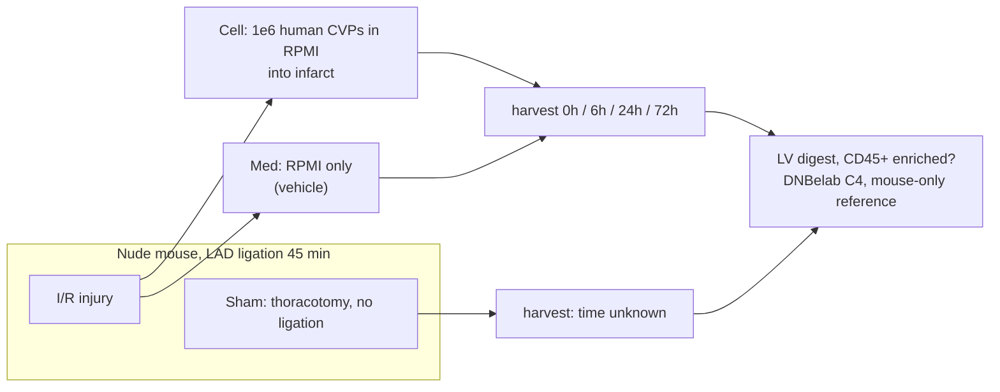

# Mouse scRNA cohort — re-interpretation against the Yap lab paper and Alder Therapeutics

Sources: Adusumalli … Yap, *Nature Cardiovascular Research* (2026), doi 10.1038/s44161-026-00851-1
(`LY_Nature CVR_July2026.pdf`, cited as "p N"); https://www.aldertx.com/ and
https://www.aldertx.com/therapies (cited as "Alder home" / "Alder therapies"); our runs
`Results/results_0hCell1_8samples_filtered` (PosA, 0h+6h) and
`Results/results_24hCell1_7samples_filtered` (PosB, 24h+72h); marker evidence in
`docs/mouse_reint_evidence_posA.txt` / `_posB.txt` (script `docs/mouse_reint_evidence.R`),
cited as "evA:line" / "evB:line". Nothing in the pipeline or result directories was changed.

## 1. Verdict

**Partly, and much more than before.** The immune-dominated profile now fits a plausible
experiment: the paper's own mouse model is ischemia/reperfusion (I/R) of the left ventricle in
nude mice with human cardiovascular progenitors (CVPs) or medium injected into the ischemic
region (p16), and our cells look like the inflammatory infiltrate of such a heart — Ccr2+
monocyte-derived Spp1/Trem2/Arg1 macrophages, SiglecF+ neutrophils, cardiomyocyte ambient RNA,
and almost no fibroblasts, consistent with a CD45-enriched heart digest. Two things still do
not fit and need your answer: the "0h" samples already look inflamed, and the human CVPs are
invisible because the data were aligned to a mouse-only reference.

## 2. What the sources say

| Claim | Source | Consistent with our data? |
|---|---|---|
| ALD02 is Alder's allogeneic hPSC-derived cardiac cell therapy for heart failure; the cells are committed cardiac progenitors | Alder home ("ALD02 – Tackling heart failure"); Alder therapies ("Research Highlights": "Pluripotent stem cell-derived committed cardiac progenitors remuscularize damaged ischemic hearts… in pigs") | n/a — motivation |
| ALD02 claims engraftment, low dose, no purification, no fatal arrhythmia; pig LVEF +20 % | Alder therapies ("Benefits", "Promising preclinical data") | n/a |
| The CVPs are human; in vivo they are tracked with human-specific Ku80 and human-prefixed genes on a combined reference | p2 Fig 1; p15 "custom combined reference genome (Pig + Human)" | **No** — our matrices are mouse-only: all 32,586 features are `ENSMUSG` (`Samples/Mouse/0hCell_1/filter_matrix/features.tsv.gz`). Human cells cannot be scored |
| Mouse model: male CrTac:NCr:Foxn1nu **nude** mice, 45-min LAD ligation, 1×10⁶ CVPs in 10 µl RPMI injected into the infarct at 40 min, then reperfusion | p16 "Mouse I/R and cell transplantation" | Plausibly yes — see §3 |
| Mouse groups: **medium only**, Ctrl-CVP, MDK-OE CVP, healthy (n = 5), 7-day endpoint | p16; p11; p13 Fig 8a | "Med" = medium-only vehicle is **confirmed** as the paper's convention [inferred for this dataset] |
| Pig groups: CVP, RPMI 1640 medium Ctrl, **sham** | p14 "Male Yorkshire Landrace pigs…" | Sham = sham-operated control, as you said |
| Medium Ctrl shows the injury effect (CD31 down vs healthy); CVPs raise CD31+ vessels; MDK-OE raises them further | p11 | Not testable in our data (no endothelial depth) |
| Paper names early immune response as the gap: "shorter time points (2–7 days) could additionally illuminate early transcriptomic responses related to graft survival and immune modulation"; also "inflammatory cell characterization" | p14 (limitations) | **Yes** — our 0–72 h immune time course is exactly this gap [inferred] |
| Host–graft signalling at week 1 includes SPP1–integrin and IL34–CSF1R | p9 | Spp1 is in 93 % of macrophages in our clusters 0/6/8 (evA:44) [same pathway, different species/time] |

## 3. What our cells say about the tissue and the mouse

| Question | Evidence | Reading |
|---|---|---|
| Heart, peritoneum, or other? | Peritoneal large-macrophage markers absent: Gata6 0–1 %, Prg4 0–3 %, Icam2 ≤ 14 % (evA:17–23). Alveolar/splenic markers absent (Marco ≤ 1 %, evA:25–31). Cardiomyocyte transcripts present as ambient: Mb/Myl2/Tnnt2 in 1–8 % of cells at 0–24 h and 10–30 % at 72 h (evA:203–212, evB) | **Heart** [inferred] |
| Whole digest or immune-enriched? | Fibroblast markers near zero: Col1a1 ≤ 3 %, Pdgfra 0, Tcf21 0 (evA:193–199); endothelium one small cluster (Cdh5 47 %, n≈171, evA:89) | **Immune-enriched (likely CD45+ selection)** [inferred] |
| Injured? | Macrophages are Ccr2+ (46–91 %), Ly6c2+, Chil3+, Arg1+, Spp1+ (≈93 %), Trem2+ (evA:144–160) = monocyte-derived, post-injury. Resident-type Timd4/Lyve1 macrophages are rare (one cluster, 7, n small; evA:10–11). SiglecF+ neutrophils present (clusters 4 and 14, 28–29 %; evA:27) — a subset typical of the infarcted heart [inferred, literature] | **Yes, ischemic injury** |
| Nude mice? | Real αβ T cells exist but are few: one Cd3e+ Trac+ cluster of 886 cells (2 % of PosA; evA:251); 2–11 % Trac+ per sample in PosB (evB). B cells normal | **Compatible with nude** (nude mice keep some extrathymic T cells); not proven |
| Any human CVPs in "Cell"? | Cells co-expressing ≥ 3 conserved cardiac genes: 0–0.3 % in every sample, Med as high as Cell (evA:239–248) | **None detectable** — expected with a mouse-only reference and CD45 selection |

Heavy ambient signal is also visible: S100a8/S100a9 in ~90 % of B and T cells, Saa3 and Spp1
in 50–80 % of lymphocytes (evA:44, 53–54). The mouse libraries ship `raw_matrix/`, so SoupX
(step 00) can be run on them.

## 4. Revised design

| Sample group | Most likely | Confidence |
|---|---|---|
| `<t>Med_<n>` | I/R + RPMI vehicle injected into the infarct, heart harvested t after surgery | Medium — matches paper p16; time origin unconfirmed |
| `<t>Cell_<n>` | I/R + human CVPs (Ctrl-CVP, or MDK-OE?) in RPMI | Medium — which CVP line unknown |
| `MS_Sham1/2` | Sham-operated mice (user) — heart harvested at one time point | High for "sham"; time point unknown |
| Tissue | Left ventricle / whole heart, immune-enriched | Medium (§3) |
| Strain | Foxn1nu nude, as in the paper | Low–medium (§3) |

## 5. Paper markers mapped to our clusters, and a proposed mouse panel

The paper's markers are for the human graft and pig host, not immune cells: maturation (TNNT2,
ACTN2, MYL2, TTN, TCAP, CSRP3, GJA1, RYR2, PLN, FABP3, COX6A2, PDK4; p4–p7), fibrosis (COL1A1,
COL1A2, FN1, LUM; p7), vessels (VWF, CD31/PECAM1, VEGFA; p9–p13), MDK axis (MDK; receptors SDC2,
SDC4, ITGB1, ITGA6, LRP1, NCL; p9–p11), and host signalling SPP1–ITG and IL34–CSF1R (p9). In our
data only the host side is measurable: Spp1 high in macrophages (evA:44), Mdk 0–5 % (evA:108),
cardiac and fibrosis genes ambient-level (evA:84–101).

**Proposed** `MARKERS` for `config_species_mouse.R` (proposal only, NOT applied; names would
need palette entries):

| Panel | Genes | Seen in our data |
|---|---|---|
| Macrophage (resident) | Timd4 Lyve1 Folr2 Cd163 Igf1 | cluster 7, Lyve1 36 %, Cd163 55 % (evA:10–15) |
| Macrophage (recruited) | Ccr2 Ly6c2 Plac8 Chil3 | most macrophages (evA:35–38) |
| Macrophage (Spp1/Trem2 repair) | Spp1 Trem2 Gpnmb Arg1 Fn1 | evA:39–47 |
| Neutrophil | Cxcr2 Mmp8 Retnlg Ly6g | clusters 3/4/14 (evA:55–58); S100a8/9 excluded as ambient |
| Neutrophil (SiglecF-hi) | Siglecf | clusters 4/14 (evA:27) |
| DC | Flt3 Ciita H2-Ab1 Clec9a Ccr7 | from the PosA marker look |
| B cell | Cd79a Ms4a1 Pax5 | cluster 9 |
| T cell | Cd3e Trac Cd4 Cd8a | cluster 10 (evA:62–69) |
| NK | Ncr1 Klrb1c Gzma Nkg7 | cluster 11 (evA:73–75) |
| Endothelial | Pecam1 Cdh5 Kdr Flt1 | cluster 15 (evA:88–90) |
| Contamination: cardiomyocyte ambient | Mb Myl2 Tnnt2 | evA:94–97 |

## 6. What the contrasts can and cannot answer

- **Cell vs Med within a timepoint** — the clean contrast: same flowcell, same surgery, differs only by the CVPs. It answers "how do human CVPs change the host immune infiltrate at t". So far: no composition difference at 0h, 6h or 24h (PosA/PosB `composition_test.csv`); pseudobulk DE at 24h finds 155 macrophage and 76 neutrophil genes (PosB `differential/DE_summary.csv`). Two replicates per arm; 72hMed has one 47-cell library, so 72h Cell vs Med cannot be tested.
- **Across time** — 0h/6h vs 24h/72h crosses flowcells (PosA vs PosB), so time and batch are confounded. Within PosB, 24h → 72h in the Cell arm is valid: macrophages up 49 → 73 %, neutrophils down 25 → 11 % (FDR < 0.01).
- **Med vs Sham** — the injury effect (I/R + vehicle vs surgery alone), provided the sham harvest time matches a Med time point.
- **Cell vs Sham** — confounds injury with cells; only interpretable through Med.
- **Graft cells themselves** — not answerable from these matrices; needs realignment to a human+mouse reference (as the paper did for pig, p15) and only if the prep retained non-CD45 cells.

## 7. Settled by the sequencing records (added 2026-10-27)

Source: `/home/alvin/storeData/DNBelab_Data/LynnYap/DNBeLabSingle-Cell3RNAMGISP100T7ExperimentalRecord_NTULKC_LY_2026finalrecords.xlsx`
(sheets "sc3'RNA LibPrep - mice (FC A/B)"), read only. Full sample-to-barcode table:
`docs/lynnyap_flowcell_barcodes_2026.csv`.

- **Tissue and prep are confirmed**: every mouse library is "Flow-sorted CD45+ mouse heart",
  resuspended in PBS + 0.04 % BSA. §3's inference (heart, immune-enriched) was right.
- **The shams are on flowcell A** with the 0h and 6h libraries (cDNA barcodes 1–2), DNB-pooled
  as "sham + 0hr media". Flowcell B is 24h and 72h only.
- **Barcodes**: on each flowcell, library *n* uses cDNA barcode *n* and oligo barcode *n* + 16
  (MGI 1–128 set); the FASTQ files carrying data match exactly.
- **Reference**: the mouse libraries were run with DNBC4tools 3.1 against GRCm38 only
  (`E250164106_POS_A/0hCell_1/logs/ref.json`).
- **Consequence for the graft question**: human CVPs are CD45-negative, so the CD45+ sort removed
  them before loading. Realigning to a human+mouse reference would at best recover a few
  contaminating graft cells or doublets; it cannot profile the graft. The scRNA is a study of the
  **host immune response** to the cells, which is exactly the gap the paper names (p14).
- **Flowcells C and D are human cardiac differentiations, already processed** against GRCh38:
  ASF5 (flowcell C) and CLMC (flowcell D), each D0/D11/D20/D30 in duplicate, in
  `E250164134_POS_C/` and `E250164148_POS_D/`. These are two more hPSC lines run on the same
  protocol as the H1 cohort and can go through the cm pipeline unchanged.

## 8. Questions still open

1. **Time axis.** Are 0h/6h/24h/72h hours after I/R surgery and injection? If so, why do the 0h hearts already contain Ccr2+ Spp1+ monocyte-derived macrophages and 13–24 % neutrophils rather than resident Timd4/Lyve1 macrophages? And at what time were the shams harvested?
2. **Strain.** Were these Foxn1nu nude mice as in the paper? (Tissue and CD45+ sort are now confirmed, §7.)
3. **"Cell".** Are "Cell" the human Ctrl-CVPs or the MDK-OE CVPs, and from which hPSC line (H1, ASF5 or CLMC)? (FASTQs are available, §7, but a human+mouse realignment would not recover the graft after a CD45+ sort.)
